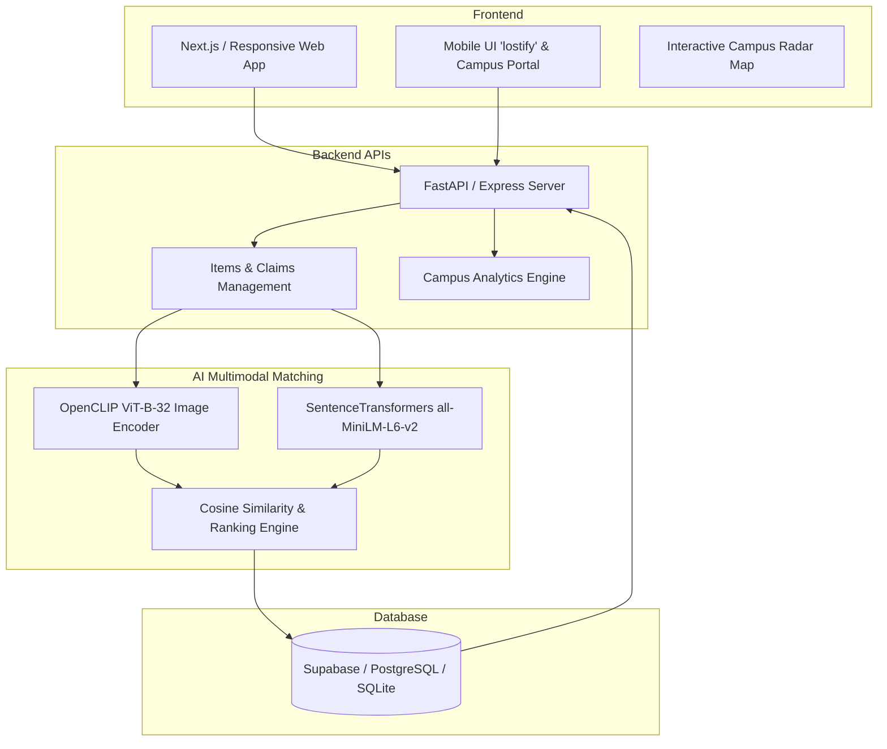

# 🔍 FindBack AI — Lost Today. Found Tomorrow.

> **An AI-powered Lost & Found Platform for Campuses**  
> Matches lost and found personal items using photos, semantic descriptions, and real-time campus radar mapping.

---

## 📸 Overview & Features

FindBack AI solves the chaos of campus lost-and-found counters using cutting-edge multimodal AI:

1. **AI-Powered Search & Matching**:
   - Uses **OpenCLIP** (visual feature extraction) + **Sentence Transformers** (semantic textual similarity) to match lost items with found items.
   - Outputs ranked matches with clear similarity percentages (**95% match, 82% match, 76% match**) and matching explanations.
2. **Campus Radar & Map View**:
   - Live campus perimeter radar (800m zone) with pins for **Bags (Green)**, **Keys (Orange)**, **Phones (Blue)**, and **Watches (Purple)**.
   - Distance calculation and visual radius indicators.
3. **Anti-Theft Claim Verification**:
   - Dual-step security questions (e.g., *"What is inside the front zipper pocket?"*) to prevent unauthorized claims.
4. **Dual Interface**:
   - **Campus Web Portal**: Full dashboard with analytics, category filters, and campus metrics.
   - **Mobile UI ("lostify")**: Pocket-sized mobile experience with quick filters and call-owner flows.

---

## 🛠️ Architecture



---

## 🚀 Quick Start (Running Locally)

### Option 1: Instant Web App (Node.js)
```powershell
cd C:\Users\Roman81\.gemini\antigravity\scratch\findback_ai
npm install
npm start
```
Open **[http://localhost:3000](http://localhost:3000)** in your browser!

### Option 2: Python FastAPI Backend
```powershell
cd backend
pip install -r requirements.txt
uvicorn app.main:app --reload --port 8000
```
Interactive Swagger API Docs: **http://localhost:8000/docs**

---

## 👥 Tech Stack
- **Frontend**: Next.js / Tailwind CSS / Lucide Icons
- **Backend**: FastAPI (Python) & Express (Node.js)
- **AI Models**: OpenCLIP (`ViT-B-32`) + Sentence Transformers (`all-MiniLM-L6-v2`)
- **Database**: Supabase / PostgreSQL
- **Hosting**: Microsoft Azure (App Service + Blob Storage)
